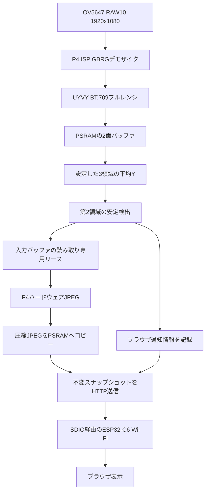

# ESP32-P4 冷蔵庫カメラ

OV5647で撮影した画像の輝度変化を検出し、変化が落ち着いた時点の1920×1080 JPEGをブラウザへ配信するRust／ESP-IDFアプリケーションです。

- **ESP32-P4**：カメラ取得、ISP、APLトリガー検出、ハードウェアJPEG、HTTPサーバー。
- **ESP32-C6**：ESP-Hosted経由の2.4 GHz Wi-Fi通信。
- **ブラウザ**：最新JPEGの表示、撮影トリガー通知、切断・P4再起動後の再試行。

連続動画の配信ではありません。全トリガーの画像を保存するキューや、ファイルシステムへの永続保存もありません。詳細なAPI・CSI／ISPの契約は [src/README.md](src/README.md) を参照してください。

> 本書のコマンドは、特記しない限りプロジェクトルートから実行します。リソース表は設定値・計算上の割り当て量であり、実機のピークヒープ使用量やCPU使用率を測定した値ではありません。

## 目次

- [必要なハードウェア](#必要なハードウェア)
- [環境構築](#環境構築)
- [Wi-Fi設定とビルド](#wi-fi設定とビルド)
- [書き込みとブラウザ表示](#書き込みとブラウザ表示)
- [内部構造](#内部構造)
- [リソース使用量](#リソース使用量)
- [設定変更の入口](#設定変更の入口)
- [検証](#検証)
- [トラブルシューティング](#トラブルシューティング)
- [制約とセキュリティ](#制約とセキュリティ)
- [参考資料](#参考資料)

## 必要なハードウェア

| 項目 | 要件・現在の構成 |
|---|---|
| メインMCU | ESP32-P4、2コア |
| 外部RAM | PSRAM必須。以前の実機起動ログでは32 MiBを認識 |
| カメラ | OV5647、MIPI CSI 2レーン、1920×1080 RAW10、公称30 FPS |
| カメラクロック | モジュール側から24 MHz XCLKを供給する現在の構成 |
| 無線コプロセッサー | ESP32-C6、ESP-Hosted 3.0.9互換FW |
| ネットワーク | PCとC6が接続できる同じLAN、2.4 GHzアクセスポイント |
| 書き込み・ログ | 基板に対応したUSB／シリアル接続とケーブル |

ESP32-P4単体にはWi-Fi無線がありません。P4へのアプリ書き込みだけではC6のFWは更新されないため、C6には対応するESP-Hosted FWを別途用意してください。C6側のビルド・書き込みはこのプロジェクトの対象外です。

### 現在の配線

| 信号 | P4 GPIO |
|---|---:|
| カメラSCCB SDA | 7 |
| カメラSCCB SCL | 8 |
| SDIO CLK | 18 |
| SDIO CMD | 19 |
| SDIO D0 / D1 / D2 / D3 | 14 / 15 / 16 / 17 |
| C6 RESET / EN | 54 |

- SDIOはslot 1、4-bit、40 MHz。CMDとD0〜D3には基板上の外部プルアップが必要です。
- カメラSCCBも外部I2Cプルアップを前提とします。
- MIPIデータ／クロックレーン、電源、コネクターの配線は基板の回路図に従ってください。
- 現在の `src/main.rs` はXCLK出力、リセット、パワーダウンのGPIOを使用しません。
- カメラモジュールの電源は外部から供給してください。MIPI PHY電源の既定値はLDOチャネル3／2500 mVですが、実際の基板との適合を確認してください。アプリ／基板側で管理する場合は `mipi_phy_supply = None` を指定します。

GPIO番号やPHY電源を他のボードへそのまま適用しないでください。

## 環境構築

### 1. ホスト側のツール

Rustup、Git、Python 3.10以上（pip／venvを含む）、CMake 3.22以上、Ninjaが必要です。以下はmacOSでの導入例で、RustupとHomebrewは導入済みとします。

```sh
# Command Line Toolsが未導入の場合
xcode-select --install

brew install cmake ninja python git

rustup toolchain install nightly --component rust-src --component llvm-tools
cargo install ldproxy --version 0.3.5 --locked
cargo install espflash --version 4.6.0 --locked
```

`ldproxy 0.3.5` と `espflash 4.6.0` は開発環境で確認した版です。`espflash 4.6.0` の導入にはRust 1.95.0以上が必要です。これらの新規インストールを各OSで検証したという意味ではありません。

Linuxではコンパイラ／開発ツールや `libudev-dev` 相当のパッケージ、USBシリアルへのアクセス権も必要です。Windows／WSLではパッケージ導入、USB接続、シェル構文が異なります。OS別の詳細は [ESP-IDFの環境構築資料](https://docs.espressif.com/projects/esp-idf/en/v6.1/esp32p4/get-started/linux-macos-setup-legacy.html) を参照してください。

### 2. RustターゲットとSDKの取得

プロジェクトの設定が次を指定します。

| 設定ファイル | 内容 |
|---|---|
| `rust-toolchain.toml` | `nightly`、`rust-src`、`llvm-tools` |
| `.cargo/config.toml` | `riscv32imafc-esp-espidf`、`build-std`、linker／runner、公式SDKの固定コミット |
| `Cargo.toml` | Rust依存と公式追加コンポーネント |
| `sdkconfig.defaults` | PSRAM、カメラ、Hosted、スタック、RTOS／TCPの設定 |

ESP32-P4はRISC-Vなので、この構成にXtensa向けカスタムRustや `espup` は必須ではありません。標準ライブラリを `build-std = ["std", "panic_abort"]` で構築するため、通常は `rustup target add` やビルド時の `--target` の再指定も不要です。

**初回はESP-IDFをactivateしていないシェルで、自動セットアップを使う方法を推奨します。** `IDF_PATH` が残っている場合は、そのビルドコマンドだけで外せます。

```sh
env -u IDF_PATH cargo build --release
```

`esp-idf-sys` が指定SDK、RISC-Vツールチェーン、バインディング生成用Clang、Python環境、追加コンポーネントをセットアップします。ツール配置は `global`、通常は `~/.espressif` です。初回はネット接続と取得先への書き込み権限が必要で、完了まで時間がかかります。

すでに `IDF_PATH` を設定している場合は、次の条件を満たすSDKを利用してください。

- originが公式HTTPS URL `https://github.com/espressif/esp-idf.git`（末尾 `.git` なしも可）。
- HEADが `fff9895c82d744c7237be8847347bdd1b07c6643` と一致。
- 追跡ファイル・サブモジュールに変更がなく、公式SDK内のCSIドライバーを使用。

`IDF_PATH` は固定した `ESP_IDF_VERSION` より優先されます。`idf/official_sdk.cmake` が上記条件を検査するため、別バージョン、fork、SSH origin、ZIP展開、CSIドライバーのoverrideは拒否されます。この検査は未追跡ファイルを含む完全な改変検出を保証するものではありません。

### 3. 固定している依存関係

| 依存 | 取得元・固定値 |
|---|---|
| ESP-IDF | 公式 `espressif/esp-idf`、6.1リリースコミット `fff9895c82d744c7237be8847347bdd1b07c6643` |
| `esp-idf-sys` | 現在のlockfileでは0.38.1。manifestは互換範囲指定 |
| OV5647センサー／SCCB | 公式 `espressif/esp-video-components`、コミット `f977b225c3ce456ac5cb9413091509e260ca635f` |
| Hosted | 公式Component Registry、`espressif/esp_hosted =3.0.9` |
| mDNS | 公式Component Registry、`espressif/mdns =1.9.0` |
| CMake utilities | 公式Component Registry、`espressif/cmake_utilities =0.5.3` |

Hostedは無改変でコンパイルし、隣接する `../esp_hosted` に依存しません。Component Manager 3.1.2のGitサブモジュールメタデータに起因するハッシュ不一致を避けるため、整合性検証を無効化せず公式配布アーカイブを使います。

Rustのnightlyは日付未固定です。再現性が必要な場合は、動作確認したRust／ツールの版、`Cargo.lock`、`components_esp32p4.lock` を保存してください。現在の `.gitignore` は `Cargo.lock` を除外しています。Cargoの `--locked` は既存lockfileを前提とし、SDKやnightlyまで固定するオプションではありません。

## Wi-Fi設定とビルド

### 認証情報

```sh
cp wifi.conf.example wifi.conf
```

`wifi.conf` を編集して、実際の2.4 GHzアクセスポイントを設定します。

```text
ssid=使用するSSID
password=使用するパスワード
```

- クォートは不要で、`=` より後のスペースは値の一部です。
- SSIDは1〜32バイト。通常のパスフレーズは8〜63バイト、64桁の16進PSKも指定可能です。
- オープンネットワークでは `password=`。パスワードがある場合はWPA2以上を要求します。
- `wifi.conf` が読み込めた場合、未知のキー、重複キー、必須キーの不足はビルド処理でエラーになります。ファイルがない場合はビルドできても、認証情報未設定のままでは起動時の検査に失敗します。値の妥当性も起動時に検査します。

**`wifi.conf` はGit管理対象外ですが、資格情報は `build.rs` によりファームウェアへ埋め込まれます。** ELF、書き込み用イメージ、ビルド成果物、詳細ビルドログも機密情報として扱ってください。

Hostedの専用storage RPCで今回の認証情報をC6のRAMへ渡します。過去に保存された資格情報を消去する処理ではありません。

### ビルド

```sh
cargo fmt --check
cargo build --release
```

成果物は通常、次のELFです。

```text
target/riscv32imafc-esp-espidf/release/esp4_fridgev2
```

`CARGO_TARGET_DIR` を変更した場合はパスが変わります。デバッグ版は `cargo build` で生成します。

環境に設定されたsccacheなどのwrapperが動作しない場合は、次のように外して確認できます。

```sh
RUSTC_WRAPPER= cargo build --release
```

Rust・SDK・Python・Component Managerの依存が取得済みの開発環境では、次の手順も利用できます。

```sh
PIP_NO_INDEX=1 RUSTC_WRAPPER= cargo build --release --offline
```

これは初回セットアップ用ではありません。`--offline` はCargoの取得、`PIP_NO_INDEX` はpipのindex検索だけを制限し、SDK／Git／Component Managerなどの通信を一括で停止しません。Pythonの必要パッケージが見つからない場合は、キャッシュだけでなく対応するwheel一式などの準備が必要です。

### SDK設定を変更した場合

`sdkconfig.defaults` は既存の生成済みsdkconfig値を上書きしません。設定変更後は生成された `sdkconfig.h` を確認し、必要に応じてSDK側の設定を再構成してください。

CMake／ヘッダー変更の後で依存側の再構成が必要な場合、この環境では次を使っています。

```sh
touch sdkconfig.defaults
cargo build --release
```

これはビルドスクリプトの再実行を促す手順であり、既存sdkconfigのリセットではありません。

## 書き込みとブラウザ表示

### P4へ書き込み

```sh
cargo run --release
```

`.cargo/config.toml` のrunnerにより、ビルド後に `espflash flash --monitor` を実行します。ポートを明示したい場合は、実際のポート名を指定してください。

```sh
# macOSの例。ポート名は実機に合わせて置き換える
ESPFLASH_PORT=/dev/cu.usbmodemXXXX cargo run --release
```

既存ELFを直接書き込む場合：

```sh
espflash flash --monitor --port /dev/cu.usbmodemXXXX \
  target/riscv32imafc-esp-espidf/release/esp4_fridgev2
```

この手順はP4だけを更新し、C6のFWを書き換えません。ブートモードやUSB接続の切り替えは基板の手順に従ってください。

### ブラウザで表示

同じLANのPCから **http://esp4-fridge.local/** を開きます。mDNSが使えない場合は、ルーターのDHCP一覧でIPを確認してアクセスしてください。IP直指定で運用する場合はDHCP予約を推奨します。

- JPEGの解像度は**1920×1080**。アプリの品質は**60**で、`jpeg::encoder::Config::default()` の既定値80とは異なります。
- 通常200 msごとに最新画像を確認し、同じ画像なら本文をダウンロードしません。
- トリガーから表示まで約2秒を目標としますが、無線速度・再送・画像サイズに依存し、保証しません。
- 画像転送中の新しいトリガーは、現在の転送・デコード完了後のポーリングで確認します。途中キャンセルや全トリガー配信キューはありません。

| URL | 内容 |
|---|---|
| `/` | 外部サービス不要のブラウザページ |
| `/latest.jpg` | 最新JPEG。表示済みの起動ID／更新番号を付けると同じ画像なら204 |
| `/status` | 起動ID、更新番号、フレーム番号、JPEGサイズ |
| `/image.jpg` | 指定した最新JPEGを取得する既存クライアント向けAPI。取得競合時は409 |

JPEGがまだない場合は503です。`/latest.jpg` の204は「新しい画像なし」であり、オフラインを意味しません。

撮影時は「撮影トリガーを検出しました（フレーム N）。」を表示します。通知はJPEG投入前に記録され、処理中で画像生成をスキップしたトリガーも対象です。通知は撮影成功や画像更新完了を意味しません。ヘッダー `X-Fridge-Trigger` から表示するため本文のデコードを待ちませんが、画像転送中に発生した通知の取得は次のポーリングまで遅れます。

開いてあるページは切断時も前の画像を残し、最大5秒間隔で再試行します。P4再起動後はNVSの起動カウンタで更新番号のリセットを識別します。NVSは自動消去せず、書き込み失敗時は起動エラーにします。NVSを手動消去した場合はブラウザを再読み込みしてください。

通常のアプリINFOログは `Capture trigger: frame N, center APL=…, delta=…` のみです。WARN／ERRORは残ります。ROM／ブートローダー／アプリ初期化前のログは別です。

## 内部構造

### データの流れ



### ソース配置

```text
.
├── Cargo.toml / Cargo.lock
├── rust-toolchain.toml
├── .cargo/config.toml
├── sdkconfig.defaults
├── components_esp32p4.lock
├── build.rs
├── wifi.conf.example
├── idf/
│   ├── CMakeLists.txt
│   ├── bindings.h
│   └── official_sdk.cmake
├── src/
│   ├── main.rs
│   ├── README.md
│   ├── logger.rs
│   ├── pthread_config.rs
│   ├── camera.rs
│   ├── camera/{capture,buffers,stop,thread,trigger}.rs
│   ├── jpeg.rs
│   ├── jpeg/{encoder,pixels,probe}.rs
│   ├── wifi.rs
│   ├── wifi/{service,defaults,http,nvs,store}.rs
│   └── wifi/page.html
└── tests/
```

`camera.rs`・`jpeg.rs`・`wifi.rs`は **`pub mod` 宣言だけ**の入口です。型・関数の実装は各ディレクトリにあります。

| モジュール | 役割 |
|---|---|
| `camera::capture` | センサー／I2C／CSI／ISPの所有、フレーム取得とリース |
| `camera::buffers` | 2面のアトミックな所有状態、平均輝度 |
| `camera::thread` | CPU0の取得スレッド、WDT |
| `camera::trigger` | APL差分・安定／再アーム検出 |
| `camera::stop` | 非公開SDK型を使う安全なCSI停止ヘルパー |
| `jpeg::encoder` | CPU1のJPEGワーカー、入力レイアウト較正、エンコード |
| `jpeg::pixels` / `probe` | フォールバックの再パッキング／較正JPEGの解析 |
| `wifi::service` | STA接続、再接続、HTTPハンドラー、JPEG公開 |
| `wifi::defaults` / `http` | SDK初期値のRust実装、HTTP設定と期限付き送信 |
| `wifi::nvs` / `store` | 起動カウンタ／画像予算・不変スナップショット |

### 所有権と処理の制限

- 2面のカメラバッファを `FREE / DMA / READY / HELD` で管理します。借用やリースが残るバッファにDMAは書き込みません。
- JPEGが一方を保持すると、CSIはもう一方を再利用します。処理が遅いとフレームは取りこぼしますが、センサーの公称30 FPS設定は変えません。
- JPEG要求は単一トークンでキュー内／処理中の1件に制限します。busy時のトリガーをため込みません。
- 較正でネイティブUYVYが確認された経路は、カメラ→JPEG入力が**ゼロコピー、ピクセルごとの前処理なし**です。APL計算自体には領域内のY値の読み取りが必要です。
- 非ネイティブ経路だけ1面のスナップショットをコピーして再パッキングします。色行列・レンジ変換は行いません。
- JPEG公開では圧縮データを別のPSRAM領域へコピーします。HTTPは不変の `Arc` スナップショットを保持し、エンコーダー出力の再利用や低速クライアントから独立します。
- JPEGのDMA停止を確認できないエラー時には、関連メモリとエンジンを再起動まで保持します。自動的な再初期化・メモリ再利用は行いません。

### RustとESP-IDF

Rustは `esp-idf-sys` から公式SDK／センサードライバーを直接呼びます。`esp-idf-svc`／`esp-idf-hal` は採用していません。svc導入時は旧I2Cドライバーとの競合、HTTPの設定差、NVS自動消去などの検証が必要です。

`idf/` はヘッダーだけの設定用コンポーネントです。CMakeはSDK依存と非公開CSIヘッダーの検索パスを公開し、公式SDKを検査します。独自の実行時CソースやHostedの修正コピーはありませんが、ESP-IDF・公式センサー・Hosted自身のCコードはコンパイルされます。

## リソース使用量

### PSRAMの主要割り当て

UYVYは1ピクセルあたり2バイトです。1920×1080のストライドは3840バイトです。

| 用途 | 数量・容量 | ペイロードのバイト数 |
|---|---|---:|
| カメラ取得バッファ | 4,147,200 B × 2面 | 8,294,400 |
| JPEG出力 | 2 MiB固定容量 | 2,097,152 |
| JPEG入力のフォールバック | 非ネイティブ時だけ1面 | 4,147,200 |
| 公開JPEGの合計予算 | 最新・送信中の旧画像・作成中画像を合計 | 最大8,388,608 |
| 起動時較正入力 | 32×16×2、較正後に解放 | 一時的に1,024 |

| 経路 | カメラ＋JPEGの永続ペイロード | 公開JPEG予算を全使用した場合 |
|---|---:|---:|
| ネイティブUYVY | 10,391,552 B（約9.91 MiB） | 18,780,160 B（約17.91 MiB） |
| 再パッキングのフォールバック | 14,538,752 B（約13.87 MiB） | 22,927,360 B（約21.87 MiB） |

これは**主要ペイロードの合算**です。アロケーターの管理領域・アラインメント、`Arc`・チャネル、ドライバー、ネットワーク／Hosted、タスクスタック、TCBなどは含みません。JPEGアロケーターが返す実容量もアラインメントで増える場合があります。32 MiB PSRAMでも、特にフォールバックでは残りの余裕を実機で確認してください。

JPEG出力容量は以前の8 MiBから2 MiBへ削減し、PSRAMを6 MiB節約しています。1920×1080・品質60は維持します。画像の細かさ・ノイズ・品質設定で圧縮サイズは増えるため、2 MiB以内に収まることは実機で確認してください。容量不足などでJPEG処理がエラーになると、現在の実装はDMA関連リソースを再起動まで保持してワーカーを終了します。

CSIのバックアップ用3面目は無効です。公開JPEGは実際の圧縮サイズだけを確保し、HTTPクライアントは同じ不変画像を共有します。クライアントごとに必ず画像1枚をコピーするわけではありません。予算不足時は新画像の公開をスキップして旧画像を保持します。

### タスク・内部RAM・ネットワーク

| タスク | コア | 優先度 | スタック設定 |
|---|---|---:|---:|
| `camera_capture` | CPU0 | 5 | 8,192 B |
| `jpeg_encode` | CPU1 | 4 | 8,192 B |
| `wifi_reconnect` | CPU1 | 3 | 8,192 B |
| HTTPサーバー | CPU1 | 4 | 8,192 B |
| main | 現在の生成設定ではCPU0 | 1 | SDK設定8,192 B |
| デフォルトイベントループ | 現在の生成設定ではCPU0 | 20 | SDK設定4,096 B |
| Idle0／Idle1 | 各コア | 0 | 各4,096 B |

アプリのpthreadスタックは内部RAMを明示的に要求します。SDKのmain・イベントタスクなどは作成時に追加スタック分を加算する場合があり、表はすべての実割り当て量の合計ではありません。Hosted、lwIP、mDNS、タイマーなどの追加タスクも動作します。スタックのhigh-water markやCPU利用率は未測定です。

- FreeRTOS：**1000 Hz**。`vTaskDelay(1)` は1 ms。カメラ／JPEGはWDT監視とidleへの実行時間確保を維持します。
- アプリWDT：現在の設定では5秒。カメラ取得待ちは2秒、JPEGハードウェア呼び出しの期限は1000 ms。
- TCP送信容量：**32,768 B／接続**。これは容量設定であり、即時割り当て量や接続全体のメモリ使用量ではありません。
- HTTPクライアント用セッション：最大3。サーバー内部ソケットなどは別で、SDK全体のソケット上限も共有します。
- HTTP処理：1つの同期サーバータスクで、応答を1件ずつ送信します。
- 1回のsend：最大4096 B。この長さ制限のために画像用4 KiBバッファを追加するものではありません。
- HTTP送受信待ち：個別3秒。応答送信の絶対期限は10秒ですが、すでにブロックしているsendの終了まで最大約3秒余分にかかり得ます。
- `TCP_NODELAY`、送信後のセッション終了、キャッシュ抑止を使用。C6のWi-Fi省電力は `WIFI_PS_NONE` で無効化します。

### Flash・静的領域と測定上の注意

以前の実機ログでは **16 MiB Flash／32 MiB PSRAM** が認識されました。一方、本書作成時の生成済みSDK設定は **Flash 2 MB・DIO・80 MHz・single-app** です。`sdkconfig.defaults` はFlashサイズを明示していません。物理容量、ビルド時のFlash設定、パーティション容量は同じものではないため、書き込み前にボードと生成設定の整合を確認してください。

現在の生成設定ではCPUは400 MHz、PSRAMはHEXモード200 MHzで、内部メモリの予約設定は32 KiBです。PSRAM容量そのものはSDK起動時に認識され、defaultsだけで32 MiBを保証するものではありません。

本書作成時に確認したrelease ELFの静的セクションの参考値：

| セクション | バイト数 |
|---|---:|
| `.flash.text` | 684,486 |
| `.flash.rodata` | 289,352 |
| `.iram0.text` | 62,078 |
| `.dram0.data` | 15,652 |
| `.dram0.bss` | 14,296 |

このELFのファイル長は2,439,104 Bですが、**ELFのファイル長はFlash書き込みイメージのサイズではありません**。初期化済みの割り当て対象セクションの合計は1,052,771 Bで、イメージヘッダー・パディングなどを含みません。上記は既存成果物の参考スナップショットであり、変更ごとに再確認が必要です。

動的PSRAMの大きな割り当てはこの静的セクション表には含まれません。また、SDKビルド内の `libespidf.bin` はRustアプリ全体のサイズを示すとは限りません。今回、現在のアプリの最終 `.bin` サイズ、実機のヒープ残量・ピーク使用量は測定していません。

## 設定変更の入口

| 変更したい項目 | 主な変更先 |
|---|---|
| Wi-FiのSSID／パスワード | `wifi.conf`。変更後に再ビルド・P4へ書き込み |
| SDA／SCL、XCLK、PHY電源 | `src/main.rs` のカメラ `Config` |
| APL計算領域、しきい値 | `src/main.rs` |
| JPEG品質 | `src/main.rs` の `encoder::Config` |
| JPEG出力容量 | `src/jpeg/encoder.rs` |
| 公開JPEGの予算 | `src/wifi/service.rs` |
| HTTPソケット数・送信期限 | `src/wifi/http.rs` |
| SDIO配線、クロック、RTOS／TCP設定 | `sdkconfig.defaults` と生成済みsdkconfig |
| ブラウザUI | `src/wifi/page.html`。書き込み後にブラウザを再読み込み |
| SDK／公式コンポーネントの版 | `.cargo/config.toml`、`Cargo.toml`、SDK検査。互換性の再検証が必要 |

現在のAPL領域は `(x, y, width, height)` で次の3つです。

```text
(0,   0,  192, 108)
(192, 0,  192, 108)
(384, 0, 1536, 108)
```

検出に使う `means[1]` は第2領域です。API／ログの `center` は画面の幾何学的な中央を意味しません。しきい値は安定差分の絶対値0.05、安定2フレーム、再アーム差分の絶対値0.2で、生のY値の取得フレーム間差分です。フレームの取りこぼしやISP設定によって意味が変わるため、実機で調整してください。

## 検証

すべてのホスト側モジュールテストをまとめて実行するには：

```sh
./run_tests.sh
```

Rustテスト8種類、ブラウザテスト、ネットワーク初期値テスト、公式SDK検査テストを順に実行します。失敗時は直ちに終了し、終了コードは非ゼロになります。Rustテストはワーニングもエラーとして扱います。実行場所にかかわらずプロジェクトルートへ移動し、テストバイナリは `target/module-tests/` に出力します。

必要なツールは `rustc`、Node.js、Python 3、CMakeです。ネットワーク初期値テストには `IDF_PATH` または既存のreleaseビルドのSDK情報が必要です。スクリプト自体はファームウェアのビルド・書き込みを行いません。

個別にビルド・テストする場合：

```sh
cargo fmt --check
cargo build --release

mkdir -p target
rustc --edition=2021 --test tests/camera_buffers.rs -o target/camera_buffers_tests
./target/camera_buffers_tests
rustc --edition=2021 --test tests/camera_stop.rs -o target/camera_stop_tests
./target/camera_stop_tests
rustc --edition=2021 --test tests/jpeg_pixels.rs -o target/jpeg_pixels_tests
./target/jpeg_pixels_tests
rustc --edition=2021 --test tests/jpeg_probe.rs -o target/jpeg_probe_tests
./target/jpeg_probe_tests
rustc --edition=2021 --test tests/trigger.rs -o target/trigger_tests
./target/trigger_tests
rustc --edition=2021 --test tests/wifi_http.rs -o target/wifi_http_tests
./target/wifi_http_tests
rustc --edition=2021 --test tests/wifi_nvs.rs -o target/wifi_nvs_tests
./target/wifi_nvs_tests
rustc --edition=2021 --test tests/wifi_store.rs -o target/wifi_store_tests
./target/wifi_store_tests

node --test tests/wifi_page.mjs
python3 tests/network_defaults.py
python3 tests/official_sdk.py
```

ブラウザテストにはNode.js、SDK初期値テストには利用するSDKヘッダーまたは既存ビルド情報が必要です。ホストテストはクロスビルドする `cargo test` ではなく、上記の独立した実行形式です。

直前のモジュール整理では、releaseビルドがワーニングなしで成功し、ホストテスト135件が通っています。本書の作成で新規環境への導入や実機の書き込みを再検証したという意味ではありません。

実機では少なくとも、起動、カメラ取得、画像の色／完全性、トリガー、転送時間、切断・再起動後の復旧、CSI停止・再起動、ヒープ残量とスタック余裕を確認してください。モックSDKや所有権モデルのテストは実際の割り込み・キャッシュ・DMA競合を保証しません。

## トラブルシューティング

| 症状 | 確認事項 |
|---|---|
| SDKの公式チェックで失敗 | `IDF_PATH`、origin、HEAD、追跡ファイルの変更、CSIドライバーoverrideを確認。別SDKを使うなら検査を無効化せず互換性をレビュー |
| Pythonパッケージを取得できない | 初回に `PIP_NO_INDEX=1` を指定していないか、pip／venv、ネット接続、対応パッケージのキャッシュを確認 |
| sccache／wrapperで失敗 | `RUSTC_WRAPPER= cargo build --release` で切り分け |
| C6と通信できない | 3.0.9互換FW、電源、GPIO54、SDIO配線とプルアップ、4-bit／40 MHz設定を確認 |
| カメラ検出に失敗 | モジュール電源、24 MHz XCLK、SCCB配線・プルアップ、アドレス0x36を確認 |
| ブラウザへ接続できない | 同じLAN／2.4 GHz AP、mDNS、DHCP、クライアント隔離、ファイアウォールを確認 |
| オフライン・前の画像を表示中 | これは通信／取得／デコードの失敗表示。端末とLANを確認。初回ページロード自体が失敗した場合は復帰後に開き直す |
| 204が続く | 新しい公開JPEGがない正常応答。実際にトリガーが発生しているか確認 |
| トリガー通知は出るが画像が変わらない | JPEG busy、公開メモリ予算、エンコード／送信エラーを確認。通知は画像生成成功とは独立 |
| 画像更新が遅い | JPEGサイズ、無線環境、TCP再送、先行する画像転送を確認。公式Hostedの空き待ち条件で集約破棄が起こり得る |
| メモリ不足 | ネイティブ／フォールバック経路、公開中の旧画像、実PSRAM容量、他SDK割り当てを確認 |
| ブラウザのUI変更が反映されない | 再ビルド・P4へ書き込み後、ページを再読み込み |

## 制約とセキュリティ

- **HTTPに認証・暗号化はありません。** 同じLANから到達できる相手は画像を閲覧できます。信頼できるLANだけで使い、ポート開放でインターネットに公開しないでください。
- SSID／パスワードをソース管理、共有ログ、公開ファームウェアへ含めないでください。
- ISPはBT.709フルレンジですが、JPEG前処理でBT.601への変換は行いません。ブラウザの一般的なJPEGデコードではBT.601として解釈され、有彩色に差が出る場合があります。
- 非公開CSI／DMA APIに依存します。ESP-IDF 6.1・P4・2コアの前提を外す際は、構造体レイアウトだけでなく停止手順と割り込み動作もレビューしてください。
- キャッシュセーフISR設定は前提としていません。ISR／呼び出し先のIRAM配置と内部メモリ要件を検証せず有効化しないでください。
- アプリによる自動NVS消去、恒久的に停止したC6の自動復旧、JPEG DMAエラー後の自動エンコーダー再起動は行いません。

## 参考資料

- [実装・API・CSI／ISPの詳細](src/README.md)
- [ESP-IDF 6.1 / ESP32-P4](https://docs.espressif.com/projects/esp-idf/en/v6.1/esp32p4/index.html)
- [esp-idf-sysのビルド設定](https://docs.rs/crate/esp-idf-sys/0.38.1/source/BUILD-OPTIONS.md)
- [espflash](https://github.com/esp-rs/espflash/tree/main/espflash#usage)
- [公式ESP-Hosted](https://github.com/espressif/esp-hosted-mcu)
- [公式センサーコンポーネント](https://github.com/espressif/esp-video-components)
